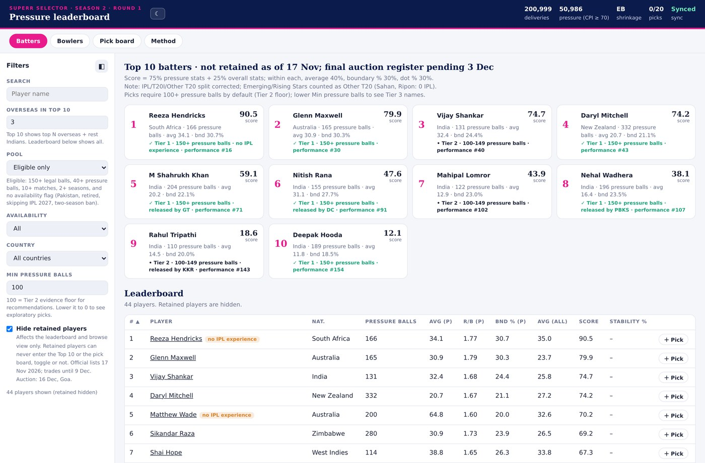
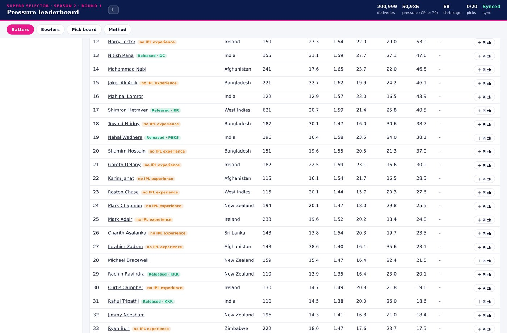
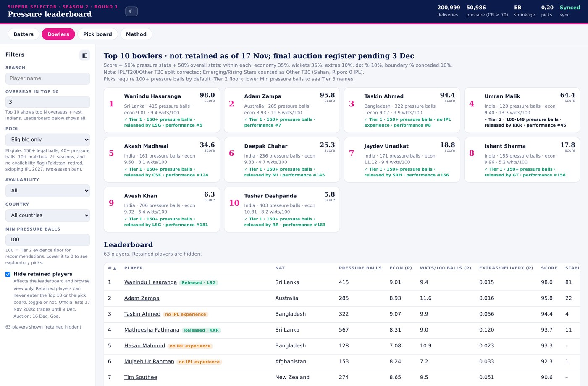
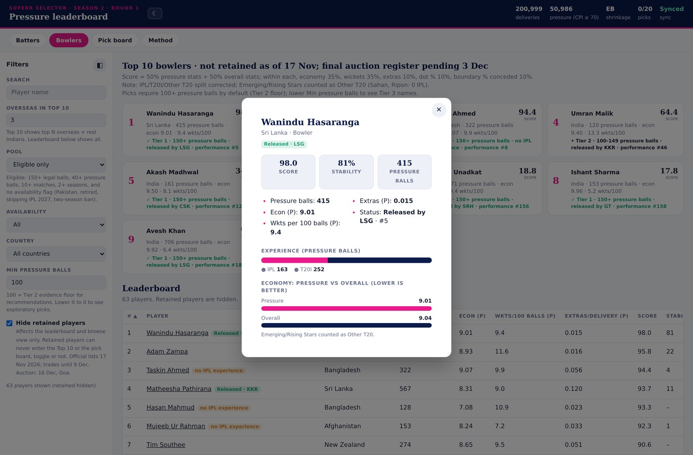
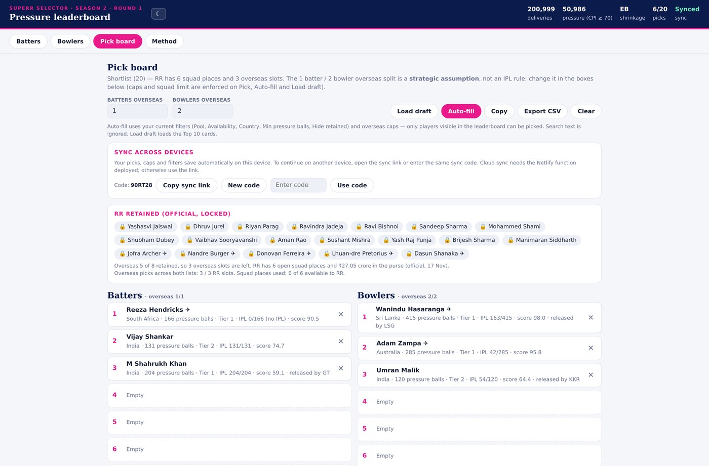
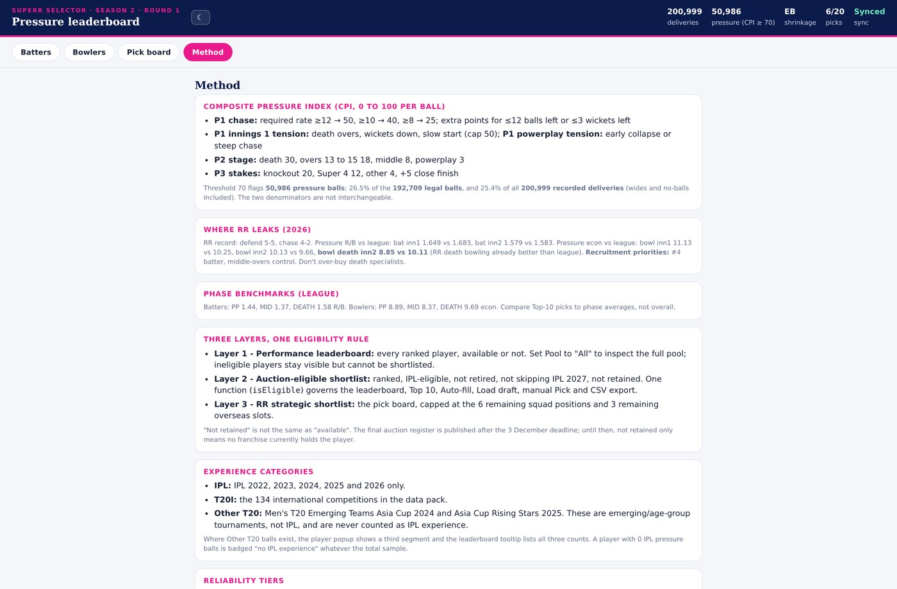
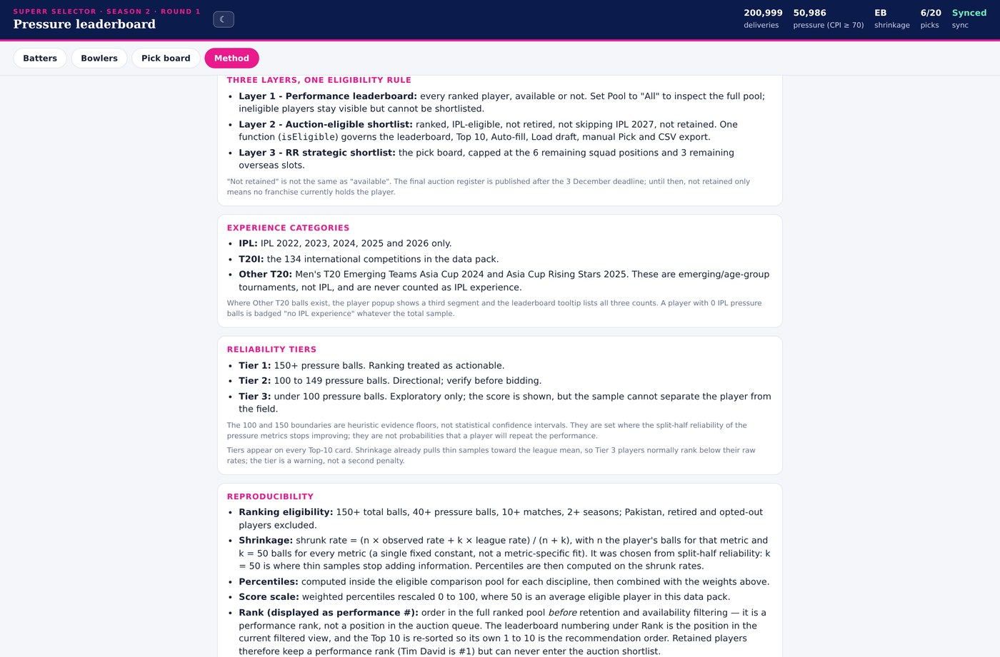
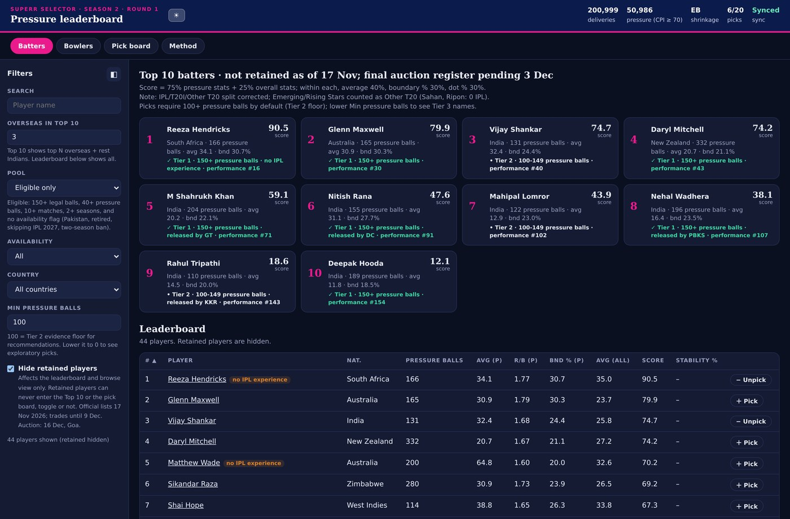
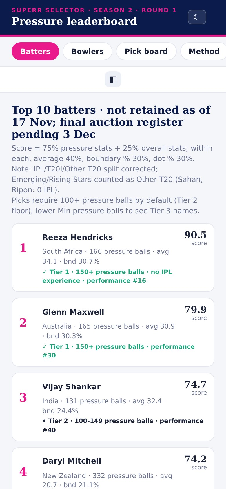

# SupeRR Selector — Pressure Leaderboard

**An auction-room dashboard for Rajasthan Royals' IPL 2027 shortlist.**
Ranks available batters and bowlers by performance under pressure, using a Composite Pressure Index
(CPI) built over 200,999 deliveries, then enforces RR's actual squad constraints on the pick board.

Single self-contained HTML file. No build step, no framework, no database to set up.



---

## What it does

| Surface | What you get |
|---|---|
| **Top 10 cards** | Batter and bowler rankings with reliability tier, pressure-ball count, IPL/T20I experience split and a one-click pick |
| **Leaderboard** | Sortable, searchable table with pressure vs overall metrics, retention badges and a "not retained" filter |
| **Player detail** | Pressure-versus-overall comparison, three-way experience split (IPL / T20I / Other T20) and the exact sample behind the score |
| **Pick board** | 20-slot shortlist with per-list overseas caps, RR's 3-slot overseas ceiling, Auto-fill from the visible leaderboard, CSV export, copy-to-clipboard |
| **Method tab** | CPI pillars, weights, shrinkage equation, reliability tiers, reproducibility chain and a written limitations section |
| **Header** | Live save/sync state (never hardcoded) and a one-click light/dark theme toggle that persists |

---

## The three layers, deliberately kept apart

1. **Performance** — every ball is scored 0–100 for pressure (situation, stage, stakes). A ball with
   CPI ≥ 70 is a pressure ball: 50,986 of 192,709 legal balls, 26.5%. Rates are shrunk toward the league
   mean (`k = 50` balls) before being converted to percentiles, so a hot fortnight cannot outrank a career.
2. **Eligibility** — retired players, players under an IPL ban, players skipping IPL 2027, Pakistani
   players and all 186 retained players are removed *before* ranking. One function (`isEligible` /
   `isAvailable`) governs the leaderboard, Top 10, Auto-fill, manual picks, draft loading and CSV export,
   so the six surfaces cannot disagree.
3. **RR fit** — RR retained 19 players (5 overseas), leaving 6 squad slots, 3 overseas slots and
   ₹27.05 crore. The pick board enforces that arithmetic instead of leaving it to the reader.

---

## Screenshots

**Batting Top 10** — the submitted list: hide-retained on, eligible pool, 100-ball evidence floor,
three overseas.


**Leaderboard** — sortable, searchable, with the pressure-vs-overall metrics behind every score.



**Bowling Top 10** — same settings, presented as a scouting list rather than a forecast.



**Player detail** — pressure vs overall, the three-way experience split, and the exact sample behind
the number.



**Pick board** — one legal RR squad: 6 of 6 squad places, 3 of 3 overseas, caps enforced per list.



**Method — the index** — CPI pillars, the RR phase gaps and the league benchmarks.



**Method — the rules** — eligibility layers, experience categories, reliability tiers, reproducibility.



**Dark theme** — one click on the ☾ header button, remembered per browser; with no stored choice the
dashboard follows the operating system.



**Responsive** — the same file at 390 px, no horizontal scroll.



---

## The data

- 200,999 deliveries · 867 matches · 141 competitions (IPL 2022–2026, 134 T20I series, 2 emerging-team T20)
- 1,217 players in the mapping (888 with batting balls, 647 with bowling balls)
- CPI ≥ 70 flags 50,986 pressure balls — **26.5% of 192,709 legal balls**, 25.4% of all recorded deliveries
- Official IPL 2027 retentions published 17 November 2026; trades open until 9 December; auction 16 December

Experience is reported in three categories, and the distinction matters: the data pack's *Men's T20
Emerging Teams Asia Cup 2024* and *Asia Cup Rising Stars 2025* are T20 competitions but **not** IPL, and
are never counted as IPL experience.

---

## Scoring in one paragraph

Batters: 75% pressure performance, 25% overall — within each block, batting average 40%, boundary rate
30%, dot-ball rate 30%. Bowlers: 50% pressure, 50% overall — within each block, economy 35, wickets 35,
extras 10, dot 10, boundary conceded 10. The weights are not arbitrary: predicting each player's pressure
value from half their matches gave r = 0.25 for pressure-only batting statistics against 0.20 for
overall-only, while no bowling scheme beat another beyond noise (r = 0.07–0.09). That last number is why
the bowling list is described as a scouting list rather than a forecast.

Reliability tiers: **Tier 1** 150+ pressure balls (actionable), **Tier 2** 100–149 (directional),
**Tier 3** under 100 (exploratory). The dashboard applies a 100-ball floor by default, so no Tier 3 name
reaches a recommendation.

---

## Repository layout

```
claude dashboard/
├── index.html                  # the entire dashboard — markup, CSS, JS and data
├── netlify/
│   └── functions/
│       └── sync.mjs            # optional cross-device sync endpoint (Netlify Blobs)
├── package.json                # the only dependency: @netlify/blobs
├── netlify.toml                 # publish dir, functions dir, security headers
├── _redirects                  # serve the dashboard at /
├── robots.txt · sitemap.xml
├── screenshots/                # images used in this README
├── LICENSE
└── SETUP_GUIDE.md              # local only — git-ignored, not published
```

---

## Cross-device sync (optional)

Opening the dashboard gives you a six-character code. Enter the same code on another device and the
shortlist, filters and caps follow you; state is also mirrored into the URL hash and `localStorage`, so a
single browser works even with no backend at all.

The badge next to it is live, not decoration:

| Badge | Meaning |
|---|---|
| **Saving…** | writing to this browser |
| **Saved** | stored locally, cloud copy pending |
| **Syncing…** | uploading to the cloud |
| **Synced** | stored here and in the cloud for your code |
| **Local** | this deployment has no sync endpoint, so nothing leaves the device |
| **Sync error** | the cloud call failed; local copy is still safe |

Hover the badge for the same explanation in a tooltip.

The cloud half needs the Netlify Function in `netlify/functions/sync.mjs` and its storage. No environment
variables are required — Netlify Blobs is available to Functions automatically once the site is deployed.
If the function is unavailable (for example when opening `index.html` straight from disk), the dashboard
degrades quietly to local-only storage.

---

## Verification

The dashboard ships with a headless-browser acceptance suite of 32 checks — boot, Top 10 rendering,
retained/ineligible refusals, draft persistence across reload, sanitisation of a deliberately poisoned
saved draft, CSV headers, Method content, 390 px layout, dark theme and sidebar collapse. Latest run:
**32/32 passed, no uncaught page errors.**

---

## License

MIT — see [LICENSE](LICENSE). Replace the copyright holder placeholder with your own name before you
publish if you care about attribution.

## Deploying

See `SETUP_GUIDE.md` in this folder for a step-by-step walkthrough (GitHub Desktop → Netlify, with
troubleshooting). That file is intentionally git-ignored, so it stays on your machine and out of the
public repository.
